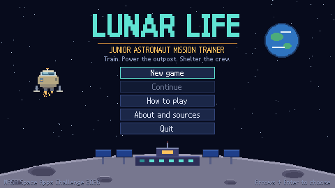
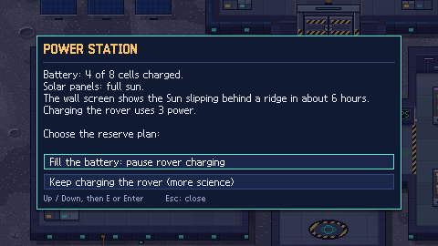
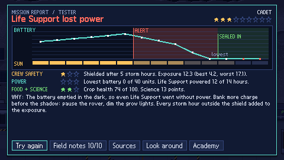

# Lunar Life

### A pixel-art lunar outpost game about crew safety, space farming, and solar storms.

**Lunar Life** is a playable educational game created by a three-person team for the 2026 NASA Space Apps Challenge. Over a five-day mission, players train as an astronaut, keep a lunar research outpost running, grow food, and shelter the crew during a solar-particle-event alert based on a NASA DONKI record.

> Team project by Kareem Dahrouj, Aryan Patel, and Jimmy Lam.

### Jimmy Lam's contribution

Contributed interactive astronaut-training and space-farming gameplay, including Suit Up and Floaty Fix lessons, planting and crew-health activities, lunar-regolith sorting, first harvest, and shelter-preparation features. These systems connect to the mission's task and progression flow.

## Screenshots

| Outpost operations | Mission debrief |
| --- | --- |
|  |  |

## Play

**Requirements:** Godot 4.7 or later. The project was built with Godot 4.7.2.

1. Clone or download this repository.
2. Open `project.godot` in Godot.
3. Press **F6** to run the current scene or **F5** to start the game.

The project includes a Web export preset in `export_presets.cfg`. A web build has not been published from this repository.

### Controls

| Input | Action |
| --- | --- |
| WASD / arrow keys | Move |
| E / Space / Enter | Talk, interact, or continue |
| Hold E | Open the storm-shelter hatch |
| M | Open the map and waypoints |
| N | Toggle sound |
| Esc / P | Open pause menu, field notes, tasks, and help |

## The mission

Each outpost day combines crew tasks with a short interactive lesson. Power, crops, and science carry forward between days, so choices shape the final report.

1. **Train:** astronaut selection, robotic-arm practice, suit checks, and a simulated neutral-buoyancy task.
2. **Settle in:** inspect power and greenhouse systems, plant crops, and learn how exercise supports crew health.
3. **Run experiments:** compare light recipes, sort lunar regolith samples, and collect a harvest.
4. **Monitor space weather:** identify solar events and practice reaching the shelter.
5. **Protect the crew:** react to the radiation alert, get the crew inside, and make a shelter power plan.

Fifteen field notes unlock through play. They explain the real-world fact, how the game simplifies it, and where to read more.

## What this project demonstrates

- **Systems design:** a five-day mission loop connects task completion, time, battery, crops, science, crew safety, and a final score.
- **Data-driven content:** mission days and interactive learning activities are stored separately from their gameplay systems.
- **Navigation and interaction:** the academy and outpost use grid-based route finding, mapped destinations, and contextual interactions.
- **Research-led learning:** quizzes, sorting, prediction, and small hands-on activities teach spaceflight and space-farming concepts.
- **Careful source framing:** the solar event is an archived NASA CCMC DONKI observation near Earth, not a measured lunar radiation dose.
- **Custom production tools:** Python scripts paint the room art from code-defined layouts and generate the game's synthesized audio.

## Build notes

- **Engine:** Godot 4.7 / GDScript
- **Rendering:** 2D pixel-art, Godot GL Compatibility renderer
- **Content:** JSON mission and lesson data; NASA event record cached in `data/nasa/`
- **Art and audio:** procedural room backgrounds and synthesized sound; attributions are listed in [CREDITS.md](CREDITS.md)
- **Development notes:** [five-day mission build](docs/FIVE-DAY-BATCH.md), [navigation](docs/NAVIGATION.md), and [project handoff](docs/handoff/Lunar-Life-Handoff/README.md)

## Sources and limitations

NASA DONKI recorded the event used for the alert near Earth. The game does not estimate a dose at the Moon. Exposure, power, battery, and time use simplified game units; the shadow pattern is a fictional stand-in for difficult south-polar lighting. The game is an educational simulation, not astronaut training or mission-planning software.

Read [CREDITS.md](CREDITS.md) for NASA and research sources, art and font attribution, and sound details.

## Team and portfolio use

This is a team project. Keep the collaborators and existing asset credits visible when forking or sharing it. For resume bullets and a LinkedIn-ready project description, see [Portfolio copy](docs/PORTFOLIO.md). Tailor the examples to the work you personally completed and can discuss.
